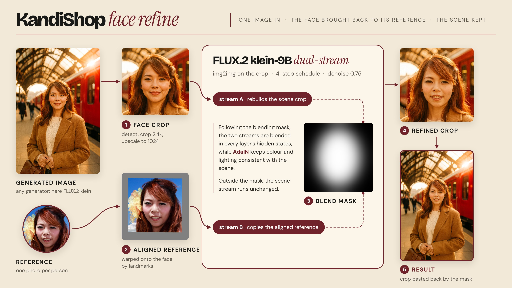
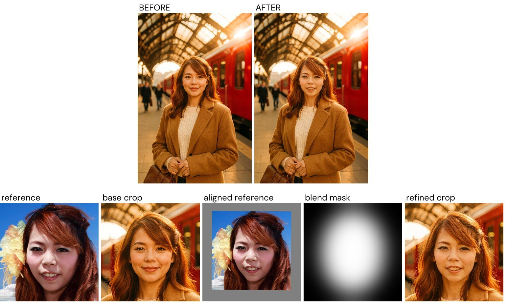
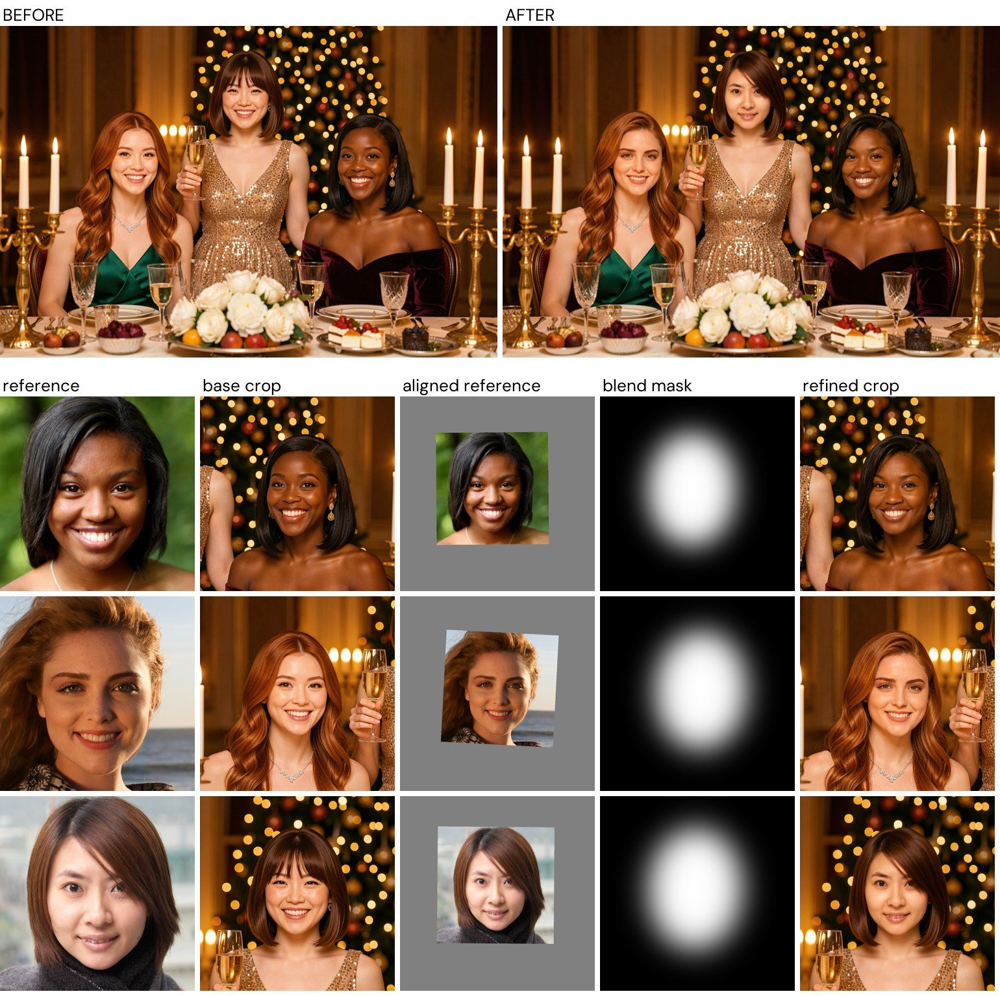
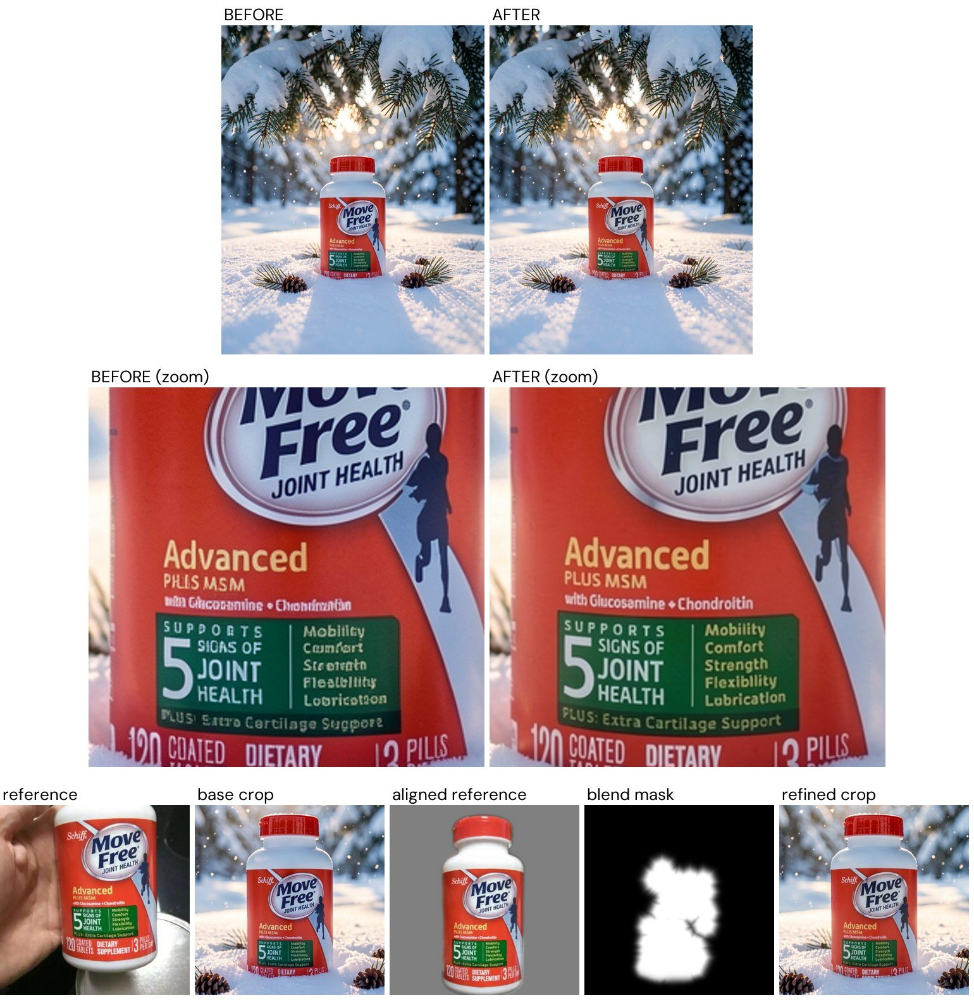
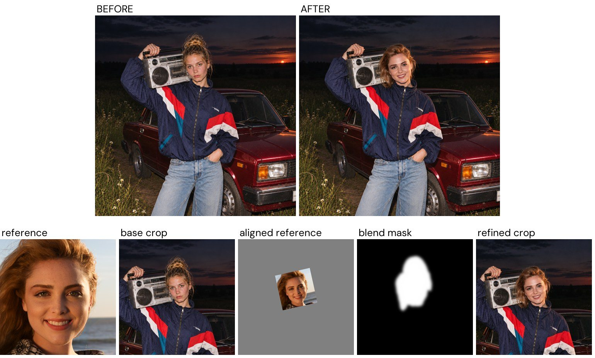
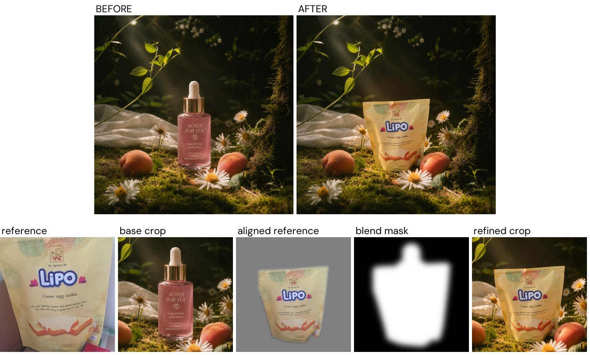

# KandiShop

Post-generation correction of faces and objects on
[FLUX.2 klein-9B](https://huggingface.co/black-forest-labs/FLUX.2-klein-9B).
KandiShop takes an existing image, whatever model made it, and brings a face or
a product back to its reference photo, leaving the rest of the scene as it was.

**Project page:** [v-gen-ai.github.io/KandiShop](https://v-gen-ai.github.io/KandiShop/)



| Script | What it does |
|---|---|
| `run_face.py` | Refines the faces in an image so they match identity references |
| `run_object.py` | Refines a product (label, typography, shape) so it matches its photo |
| `run_face_swap.py` | Puts another person's head (face and hair) into a photo |
| `run_object_swap.py` | Puts a different object in place of one in a photo |

All four run on a single GPU; the model is loaded once per call.

## Installation

Python 3.12 and a CUDA GPU with enough memory for FLUX.2 klein-9B in bf16
(tested on an 80 GB H100).

```bash
git clone https://github.com/v-gen-ai/KandiShop.git && cd KandiShop
pip install -r requirements.txt
```

Model weights are downloaded on first use:

* `black-forest-labs/FLUX.2-klein-9B` from Hugging Face, for every script. If the
  model is gated, accept its license on the model page and run
  `huggingface-cli login` first;
* `IDEA-Research/grounding-dino-base` and `facebook/sam-vit-huge` from Hugging Face,
  for the object scripts (finding and segmenting the object);
* InsightFace `buffalo_l` into `~/.insightface/models`, for the face scripts
  (face detection and ArcFace).

`run_face_swap.py` also needs the BiSeNet face-parsing checkpoint
`79999_iter.pth` from [face-parsing.PyTorch](https://github.com/zllrunning/face-parsing.PyTorch)
(MIT); the other scripts do not use it. Download it once into `weights/`:

```bash
mkdir -p weights
wget -O weights/face_parsing_79999_iter.pth \
  https://huggingface.co/vivym/face-parsing-bisenet/resolve/main/79999_iter.pth
```

To keep it elsewhere, pass `--parsing-ckpt <path>` or set `FACE_PARSING_CKPT`.

## Examples

| Folder | Contents |
|---|---|
| `examples/faces/` | Identity references `f1`–`f4`. These are faces from the [FFHQ dataset](https://github.com/NVlabs/ffhq-dataset) (Flickr-Faces-HQ, NVIDIA); each image keeps the license of its original Flickr upload |
| `examples/objects/` | Product references `o1`–`o3` |
| `examples/refs_swap/` | Target photos for the swap scripts: `lada.png` (a person) and `forest.png` (a product) |

Every command below runs from the repository root as is and produces the
pictures shown next to it. Each figure shows the full image before and after,
then, for every face or object, the intermediate steps saved with
`--save-debug 1`: the reference, the crop of the image, the reference aligned
to that crop, the blend mask and the regenerated crop.

## Face refine: `run_face.py`

The input is either a prompt or a ready image:

* `--prompt`: a base image is generated from the prompt, then refined. Both are
  saved: the base as `<name>_base.png`, the result at `--save`. By default the
  references are image conditions of the base too; `--reference-in-base 0`
  generates the base from the prompt alone and uses the references only in the refine;
* `--base`: no generation, the given image is refined.

### One person

```bash
python run_face.py --reference examples/faces/f3.png \
  --prompt "A vibrant cinematic photograph of this woman standing on a sunlit railway station platform, framed from mid-thigh up, looking into the camera with a soft confident smile. She wears a camel wool coat over a cream knit sweater and holds a small leather bag. Behind her a glossy red vintage train is waiting at the platform, an ornate wrought-iron and glass roof above, golden late-afternoon light streaming through it, warm lens flare, a few travellers softly blurred in the background. Shallow depth of field, rich warm colours, 35mm film look, photorealistic, highly detailed skin." \
  --image-size 1536x1024 --seed 2 --save-debug 1 --save out/face_single.png
```



### Several people

One reference per person, `--reference a.png b.png c.png`. Faces in the image
are matched to the references by ArcFace similarity, so the order does not
matter. Here the base is generated from the prompt alone, with no references:

```bash
python run_face.py --reference-in-base 0 \
  --reference examples/faces/f1.png examples/faces/f2.png examples/faces/f4.png \
  --prompt "A lush, glamorous photograph of three young women celebrating at an opulent festive dinner table in a grand candlelit hall. Two of them are seated at the table and the third stands between and slightly behind them, all three facing the camera and smiling. Seated on the left, a fair-skinned woman with long wavy copper-auburn hair, wearing an emerald-green silk evening gown with thin straps and a delicate diamond necklace. Seated on the right, a Black woman with sleek shoulder-length black hair, wearing a deep burgundy velvet off-shoulder gown and gold drop earrings. Standing in the middle, an East Asian woman with a chin-length chestnut-brown bob and side-swept bangs, wearing a shimmering champagne-gold sequined gown, raising a glass of champagne. The long table is laden with crystal glasses, golden candelabras with glowing candles, white roses and peonies, silver platters with fruit and desserts; behind them warm bokeh of fairy lights and a tall decorated Christmas tree. Rich jewel tones, warm golden candlelight, luxurious and joyful mood, photorealistic, 50mm lens, highly detailed. No text or lettering anywhere." \
  --image-size 1024x1536 --seed 1 --save-debug 1 --save out/face_group.png
```



To refine an existing image instead: `python run_face.py --base photo.png --reference person.png --save out/refined.png`.

**How it works.** Every face is detected, cropped (`--refine-crop-scale` 2.4 times
the face box) and upscaled to 1024 px. The crop is regenerated img2img
(`--refine-denoise` 0.75) by two streams: one reproduces the scene, the other
sees the reference aligned to the face. Inside an elliptical face mask the
streams are blended, with AdaIN on every blended step, and the crop is pasted back.

**Choosing `--refine-denoise`.** The higher the denoise, the more aggressively
the reference face is put in. For most refines 0.5 or 0.75 is right: take the
lower value when the face in the image is already close to the reference, the
higher one when it is far from it.

**AdaIN.** Keep `--adain 1` (the default): AdaIN should run on every step of the
refine.

Main options: `--refine-denoise` (0.75), `--adain` (1), `--refine-crop-scale`
(2.4), `--mask-expand` / `--mask-aspect` / `--mask-blur` (1.6 / 1.3 / 0.5),
`--seed` (42), `--save-debug 1` (crops, aligned references, masks and refined
crops into `<name>_debug/`). Several strengths in one model load:
`--refine-denoise 0.5 0.75 1.0 --save out/face_dn{dn}.png` (`{dn}` becomes `05`, `075`, `10`).

## Object refine: `run_object.py`

The same two modes, `--prompt` or `--base`, and the same `--reference-in-base`.
`--object-class` is a short English class name; the object is looked for under
it in both the image and the reference.

```bash
python run_object.py --reference examples/objects/o3.jpg --object-class bottle \
  --prompt "Product photograph of this supplement bottle standing upright in a fresh snowdrift under low-hanging snow-covered spruce branches in a quiet winter forest. The bottle fills about a third of the image height, centred, its label facing the camera, slightly sunk into the soft snow. Delicate snowflakes in the air, a few spruce needles and a small pine cone on the snow, cold blue shadows with warm low sunlight glinting through the branches behind, bokeh of distant snowy trees. Low camera angle at the bottle's height, shallow depth of field, photorealistic, highly detailed." \
  --image-size 1280x1024 --seed 1 --save-debug 1 --save out/object.png
```



**How it works.** Grounding DINO finds the object in the image and in the
reference, SAM builds the masks. The reference is fitted onto the object by
keypoints (SIFT + MAGSAC): a similarity transform, or a homography when it is
clearly better; with too few matches it is placed by mask centre and area. The
crop around the object is regenerated (`--refine-denoise` 0.7) by two streams,
blended inside the object mask, weighted towards the regions where the keypoints
agree, and pasted back with a soft edge. The log prints the fit:
`fit=similarity|homography|centroid`, `inliers=...`, `mask=...`.

Main options: `--refine-denoise` (0.7), `--refine-crop-min` (1.0 object long
sides), `--object-dilate-frac` / `--object-blur-frac` (0.04 / 0.03, blend mask),
`--composite-dilate-frac` / `--composite-edge-frac` (0.10 / 0.08, paste mask),
`--save-debug 1`.

## Face swap: `run_face_swap.py`

The head (face and hair) of `--reference` goes into the `--target` photo; scene,
pose, body and light stay from the target.

```bash
python run_face_swap.py \
  --target examples/refs_swap/lada.png --reference examples/faces/f1.png \
  --seed 3 --denoise 1.0 --save-debug 1 --save out/face_swap.png
```



Several seeds or strengths in one model load: `--seed 0 1 2 --denoise 1.0 0.75
--save out/swap_seed{seed}_dn{dn}.png` (`{seed}` is two digits, `{dn}` is `10`, `075`).

**How it works.** The same loop as the face refine, with a larger crop
(`--crop-scale` 4.4 face sizes, so that both hairstyles fit) and a head
silhouette from BiSeNet face parsing as the blend mask. By default
(`--mask-mode union`) it is the union of the target's head and the aligned
reference head, hair included: the old hairstyle goes, the new one fits whole.
`--mask-mode parsing` intersects the faces and unions the hair (the face outline
stays from the target); `--include-hair 0` keeps the target's hairstyle. The
whole crop is pasted back.

Main options: `--denoise` (1.0 0.75), `--seed` (0), `--adain-alpha` (1.0),
`--mask-blur-frac` / `--mask-dilate-frac` (0.15 / 0.06 of the inter-ocular
distance), `--composite-area crop|mask`, `--save-debug 1`.

## Object swap: `run_object_swap.py`

The object from `--reference` replaces the `--object-class` object in `--target`.
`--source-class` is what to look for in the reference when it is a different
kind of object (default: `--object-class`).

```bash
python run_object_swap.py \
  --target examples/refs_swap/forest.png --reference examples/objects/o2.jpg \
  --object-class bottle --source-class bag \
  --size-metric bbox_height --size-ratio 0.8 --place bottom \
  --seed 0 --save-debug 1 --save out/object_swap.png
```



**How it works.** Both objects are found and segmented as in the object refine.
The new object is placed on the old one (`--place`: `bbox` centres, `bottom`
edges or mask `centroid`), scaled so that `--size-metric` matches times
`--size-ratio`, and the two silhouettes are unioned so that the old object
disappears. The crop is regenerated from scratch (`--denoise` 1.0) and pasted back.

Main options: `--size-metric` (`bbox_width`, `bbox_height`, `sqrt_area`,
`bbox_max`, `bbox_diag`), `--size-ratio` (1.0), `--place` (`bbox`),
`--refine-crop-min` (1.2), `--save-debug 1`.

## Common options

All scripts take `--model-id` (`black-forest-labs/FLUX.2-klein-9B`), `--steps`
and `--guidance` (the checkpoint's defaults: 4 and 1.0) and `--seed`.
`run_face.py` and `run_object.py` also take `--image-size` (`1024x1024`, `HxW`)
for the generated base.

## Timing on one H100

| Stage | Time |
|---|---|
| Process start and FLUX load | ~38 s |
| Base generation | ~2–3 s |
| Face refine, one person | ~8–10 s |
| Face swap | ~7–10 s |
| Object refine or swap | ~8–10 s |

## Layout

| Path | Contents |
|---|---|
| `run_*.py` | Entry points |
| `flux2/pipeline.py` | FLUX loading and base generation |
| `flux2/face.py`, `flux2/product.py`, `flux2/head_swap.py` | Face refine, object refine and swap, head swap |
| `flux2/generate.py`, `adapter.py`, `latents.py`, `token_zoom.py` | Dual-stream generation on FLUX.2 |
| `objects/` | Object detection, masks, reference fitting |
| `utils/` | Face detection and alignment, masks, ArcFace, BiSeNet, compositing, timing |
| `weights/` | BiSeNet face-parsing checkpoint for the face swap (downloaded, see Installation) |
| `examples/` | Inputs for the commands above |
| `assets/` | Figures for this README |

## License

The code in this repository is released under the [MIT License](LICENSE).

The images on the project page, and any parts of them, are © 2026 KandiShop
authors, all rights reserved: they may not be used in any form, commercial,
academic or other, without our written permission.

Model weights (FLUX.2 klein-9B, Grounding DINO, SAM, InsightFace, BiSeNet) and
the FFHQ faces in `examples/faces/` are not covered by it and keep their own licenses.
